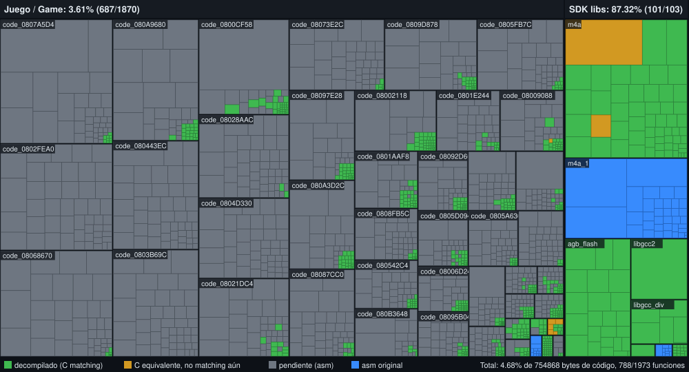

# Shining Soul II (Europe) — Decompilation


Work-in-progress **matching** decompilation of *Shining Soul II* for the Game Boy
Advance (Europe, `AU2P`, En/Fr/De/Es/It). The build reproduces the original ROM
byte for byte.



Each cell is one function (area = size in bytes): **green** = decompiled to
matching C, **grey** = still assembly, **blue** = original hand-written
assembly (start up code, m4a sound engine core, libgcc).

## Building

The ROM is **not** included. You need your own dump, saved as `baserom.gba`:

| File          | SHA1                                       |
|---------------|--------------------------------------------|
| `baserom.gba` | `aa1288be9257337abdfe3034898cf6c7aa778fbc` |

Requirements (Debian/Ubuntu): `binutils-arm-none-eabi gcc-arm-none-eabi make python3 git gcc`.

```sh
./tools/install_agbcc.sh      # builds pret/agbcc into tools/agbcc
make -j$(nproc) compare       # -> shiningsoul2_eu.gba: OK
make progress                 # regenerate docs/progress/*.svg
```

## Contributing / local continuation
See [CLAUDE.md](CLAUDE.md) for the full workflow and tools.

## Layout

| Path | Contents |
|------|----------|
| `src/*.c` | C modules. Not yet decompiled functions are pulled in with `INCLUDE_ASM(...)` |
| `asm/nonmatchings/<module>/<func>.s` | one assembly file per not yet decompiled function |
| `asm/crt0.s`, `asm/*.s` | hand written assembly (start up, m4a core, libgcc) |
| `data/rodata.s` | ROM data, taken from `baserom.gba` with `.incbin` |
| `include/` | headers |
| `tools/config/functions.cfg` | function list (address, name) |
| `tools/config/modules.cfg` | module boundaries |
| `tools/scripts/` | analysis, asm generation and progress tools |

To decompile a function: replace its `INCLUDE_ASM` line in `src/<module>.c` with C
code, delete its `.s` file and run `make compare`.

See [`docs/RESEARCH.md`](docs/RESEARCH.md) (Spanish) for the research behind the
project: how other GBA decompilations work, the toolchain and the ROM layout.
